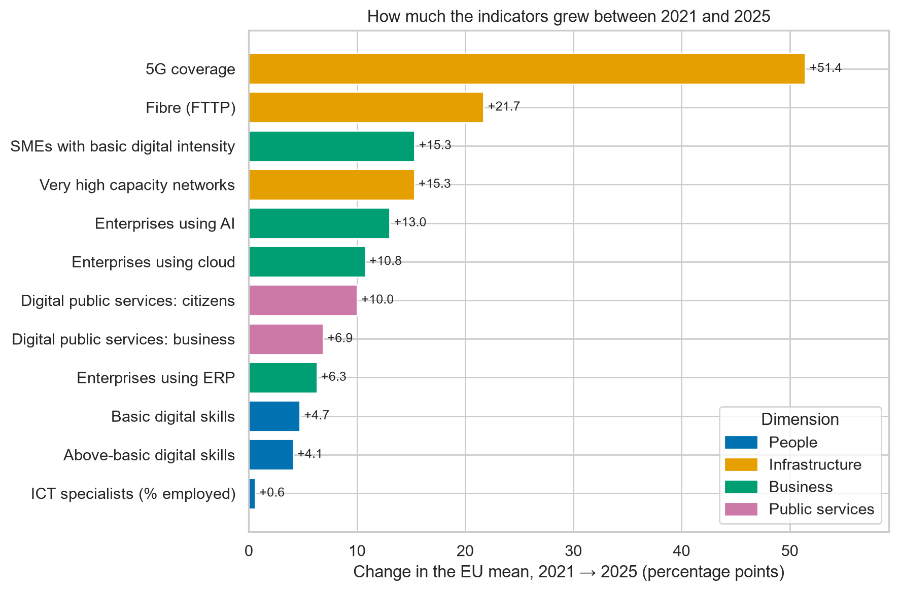
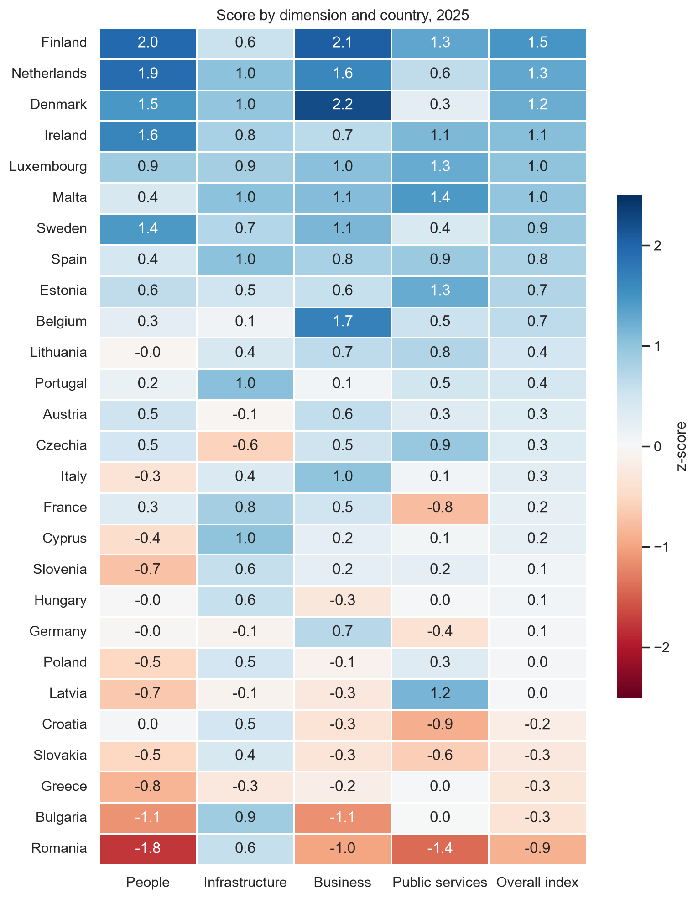
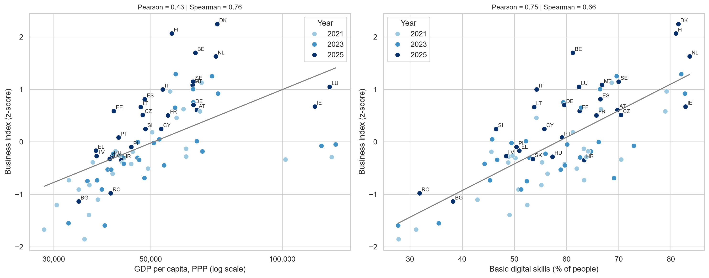
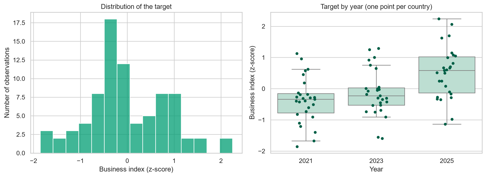

# Digital Maturity in Europe: What Explains Differences Between EU Countries?

> **Project status**: in progress. Data preparation ✅ · Exploratory analysis ✅ ·
> Target and features ✅ · Models ⬜ · Clustering ⬜

## Research question
Which structural factors (education, income, infrastructure, skills,
R&D spending) are associated with the level of business digitalisation
in European Union countries, and which groups of countries emerge?

## Objective
This project uses machine learning to analyse differences in digital maturity
across the 27 EU countries between 2021 and 2025, to identify the factors most
strongly associated with business digitalisation, and to group countries into
similar profiles.

## Data
- **Digital Decade DESI** (European Commission): indicators on skills,
  infrastructure, business and digital public services.
  Source: https://digital-decade-desi.digital-strategy.ec.europa.eu/
- **World Bank Open Data**: GDP per capita, tertiary education, R&D spending,
  urbanisation.
  Source: https://data.worldbank.org/

Panel of 27 countries over 3 years (2021, 2023, 2025): 81 observations.

## Method

The analysis has four stages.

### 1. Data preparation
- The two datasets are merged on `country` + `year`.
- World Bank variables use the value of the previous year (1-year lag), so
  that predictors precede the outcome; if a value is missing, the last known
  value up to 2 years earlier is used (documenting which cells were filled).
  No imputation is applied to the target variable.
- Explanatory variables are standardised (z-score), computed
  **on the training set only** within each fold to avoid data leakage.
  The z-scores of the target's components are instead computed on the whole
  panel: this is a declared choice that does not use target values as a
  predictor.
- Exploratory analysis: distributions, correlation matrix, multicollinearity
  check (VIF).

### 2. Target and explanatory variables
- **Target**: composite index of business digitalisation, the average of four
  standardised DESI indicators (z-scores): SMEs with at least a basic level of
  digital intensity, and enterprises using cloud, AI and ERP. Big data and
  e-commerce are excluded because they are not available for all years and
  countries.
  The target was checked for internal consistency: its four components
  correlate positively (0.43 to 0.89) and the first principal component
  explains about 73% of their variance.
- **Explanatory variables**: digital skills (basic and above-basic) and ICT
  specialists, infrastructure coverage (fibre, very high capacity networks,
  5G), log GDP per capita, tertiary enrolment, R&D spending and urbanisation.
  Unicorns and the public-services indicators are left out (they are outcomes
  of digitalisation) and may be added later as a robustness check.
- To avoid circularity, the DESI business indicators used in the target are not
  included among the explanatory variables.

### 3. Supervised models (factors associated with digitalisation)
- **Baseline**: regularised linear regression (Ridge, Lasso, Elastic Net),
  interpretable and suited to small samples.
- **Non-linear models**: Random Forest and Gradient Boosting, to capture
  interactions and non-linearities.
- **Validation**: grouped cross-validation by country
  (`GroupKFold` / leave-one-country-out), because the three observations of
  the same country are not independent. Metrics: R², RMSE, MAE, compared
  with a naive model (the mean of the target).
- **Interpretation**: coefficients (linear models), permutation importance
  and SHAP values (tree-based models), with importance stability assessed
  across folds.

### 4. Clustering (country profiles)
- Dimensionality reduction with PCA on the standardised variables.
- Comparison of **K-means** and **hierarchical clustering** (Ward linkage).
- The number of clusters is chosen using the silhouette score, the elbow
  method and interpretability of the profiles.
- Clusters are characterised by the means of their variables and their
  evolution over time (2021 → 2025).

## Results

> Section to be completed after running the analyses. Planned structure:

## Exploratory analysis: key findings

### Growth of the indicators, 2021 → 2025


*Between 2021 and 2025, 5G coverage (+51 percentage points) and fibre
(+22 pp) grew the most, while basic digital skills grew far less (+5 pp).
Infrastructure is advancing faster than people's skills. Values are simple
(unweighted) means of the 27 countries, and the jump in AI adoption (+13 pp)
may partly reflect changes in how the indicator is measured.*

### Country profiles


*In 2025 Finland, the Netherlands and Denmark lead the overall index, while
Romania is at the bottom, followed by Bulgaria, Greece and Slovakia. Several
countries have unbalanced profiles: Belgium scores very high on business
digitalisation (1.7) but only near the average on skills (0.3), while
Bulgaria has good infrastructure (0.9) but low scores on people and business
(-1.1). Scores are z-scores (0 = average across all countries and years).*

### GDP, skills and business digitalisation


*Left: business digitalisation rises with GDP per capita, but not in a
linear way (Pearson 0.43 vs Spearman 0.76). High-income outliers such as
Ireland and Luxembourg sit below the trend, while countries such as Estonia
and Italy are well above it. Right: countries where more people have basic
digital skills tend to have more digitalised businesses (Pearson 0.75,
Spearman 0.66). These are associations across countries and years, not
causal effects.*

#### Business digitalisation index


*The index shows a common upward trend across all countries, but not a
convergence: dispersion is about twice as large in 2025 as in 2021, so the
gap between leaders and laggards has widened. Models will therefore need to
cope with a year effect and a growing spread, and the pooled histogram's
second bump may partly reflect the different years rather than distinct
country groups.*

### Model performance
| Model | R² (country-grouped CV) | RMSE | MAE |
|---|---|---|---|
| Baseline (mean) | – | – | – |
| Ridge / Lasso / Elastic Net | – | – | – |
| Random Forest | – | – | – |
| Gradient Boosting | – | – | – |

### Factors most associated with digitalisation
- Ranking of variables by importance (permutation importance / SHAP):
  *to be added*.
- Direction and shape of the associations (partial dependence plots):
  *to be added*.

### Country profiles
- Chosen number of clusters and corresponding silhouette score: *to be added*.
- Short description of each cluster and the countries in it:
  *to be added*.
- Countries that change cluster between 2021 and 2025: *to be added*.

## Limitations

- **Small sample**: 81 observations (27 countries × 3 years) limit the
  capacity of complex models and make importance estimates unstable;
  results should be read as indicative.
- **Temporal dependence**: observations of the same country are
  correlated; country-grouped cross-validation mitigates the problem but does
  not eliminate it.
- **Association, not causation**: the models identify correlations, not
  causal effects. Omitted variables and reverse causality are possible (e.g.
  more digitalisation → higher income).
- **Multicollinearity**: GDP per capita, education, R&D and skills are
  strongly correlated, so the importance of individual variables may be
  distributed arbitrarily among them.
- **Index construction**: the composite target depends on the choice of
  indicators and weights; moreover, the DESI methodology changed with the
  move to the Digital Decade framework, with possible discontinuities between
  years.
- **Data misalignment**: some World Bank indicators are published with a
  delay or with missing years; values carried over from the previous year may
  introduce error.
- **Aggregate level**: the data are national; regional or sectoral
  differences within countries are not captured (risk of the ecological
  fallacy).
- **Clustering**: clusters depend on the algorithm, the scaling of the
  variables and the chosen number of groups; they should be considered a
  descriptive summary, not a "true" classification.
- **Common time trend**: the target is standardised across all years, so it
  rises for all countries between 2021 and 2025; a year effect is therefore
  mixed into the relationships and may need to be controlled for.
- **Highly collinear predictors**: [add one line with your VIF result, e.g.
  "basic and above-basic skills are nearly redundant (VIF X)"].

## How to run the project

### Current structure
```
.
├── data/
│   ├── raw/                # CSV files downloaded from DESI (unmodified)
│   └── processed/          # datasets produced by the scripts
├── notebooks/
│   ├── 01_eda.ipynb        # exploratory data analysis
│   └── 02_models.ipynb     # target, features and CV groups (data preparation for models)
├── outputs/
│   └── figures/            # charts saved by the notebooks
├── build_dataset.py        # builds the DESI country-year panel
├── add_worldbank.py        # downloads World Bank data and merges it into the panel
├── requirements.txt
└── README.md
```
Planned notebooks: `03_models_baseline.ipynb` (baseline, regularised models,
Random Forest and validation) and `04_clustering.ipynb`.

### Requirements
- Python 3.10+
- Main libraries: `pandas`, `numpy`, `scikit-learn`, `wbgapi`, `shap`,
  `statsmodels`, `matplotlib`, `seaborn`

### Steps
```bash
# 1. Create and activate the environment, then install the libraries
python -m venv .venv
source .venv/bin/activate        # on Windows: .venv\Scripts\activate
pip install -r requirements.txt

# 2. Manually download the DESI CSV files from
#    https://digital-decade-desi.digital-strategy.ec.europa.eu/
#    and save them in data/raw/ (desi-data.csv, desi-2022-data.csv,
#    dd-trajectories-data.csv)

# 3. Build the dataset (World Bank data is downloaded by the script;
#    an internet connection is required)
python build_dataset.py
python add_worldbank.py

# 4. Open notebooks/01_eda.ipynb (VS Code or Jupyter) and run it cell by cell
```

The final dataset is saved in `data/processed/panel_full.csv`.